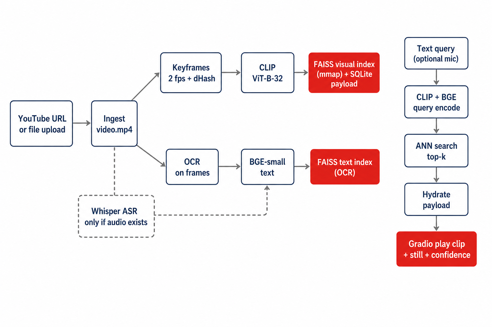
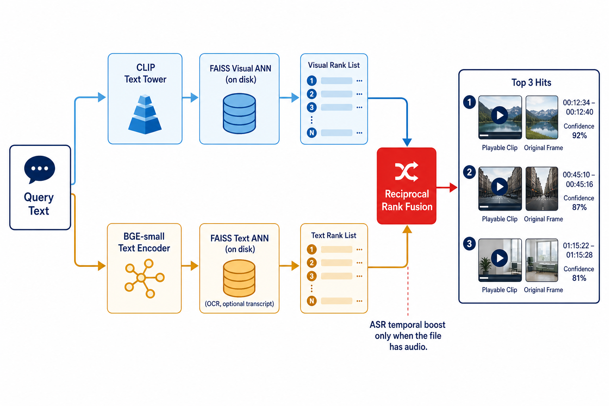

# Voice Video Search — CTO Demo Prototype

Repo: `video-voice-search` (`vvs` 0.1.0)

Audience: C-level live demo and the engineers who run or explain it.

Runtime: CPU-only local Gradio app. Source is chosen at runtime. No video is baked into the product.

When you import this page in Confluence, attach `architecture.png` and `search.png` from `docs/images/` (or drag them onto the page). A self-contained copy with those figures inlined is [`VOICE_VIDEO_SEARCH.md`](../VOICE_VIDEO_SEARCH.md).

---

## 1. Purpose

Turn one or more long-form videos into a searchable archive on a laptop.

1. Pick any YouTube URL or local file (including mute Sphere-style video). Repeat for more titles.
2. Analyze once on CPU: stills, optional speech, Qwen-VL + BGE embeddings into per-video FAISS.
3. Ask a question by typed text (voice is optional if a file has audio). **One query searches every indexed title.**
4. Play the matching moments as clips, labeled by title, with the original still, real start–end timestamps, and a confidence score.

This is a C-level demo, not a product. The rehearsed Lenovo CTO interview (`fBEGOk3ZHw4`) is an optional paste-in example. Index a second title (music video, Sphere mute clip) and the same Search box covers the whole archive.

Production-shaped retrieval: visual-first ANN over a vector store. This POC fans out across on-disk FAISS files. The same `VectorStore` interface is how one sharded Qdrant collection would be called in a real deployment.

---

## 2. What it is / is not

| It is | It is not |
| --- | --- |
| A local prototype: ingest, index, query the **archive**, play clips | A full 58 PB Sphere deployment |
| Visual-first semantic search: Qwen-VL frames + BGE (OCR / captions / ASR if audio) | A keyword / filename scan |
| On-disk FAISS ANN + SQLite payload (`visual.faiss`, `text.faiss` per video) | Embeddings loaded as a dense matrix in app RAM |
| Archive merge by **absolute ANN scores** (picture + caption + transcript + OCR) | Ranking by per-video RRF “confidence” or query-word keep/drop |
| A `VectorStore` interface with a Qdrant stub (`VVS_VECTOR_BACKEND=qdrant`) | A live Qdrant cluster in this repo |
| Gradio UI styled like Sightline (visual language only) | Sightline Sphere retrieval or any Sightline backend |
| CPU PyTorch (`pytorch-cpu` wheel index) | A GPU or cloud inference path |

After Qwen-VL Embedding, BGE, and (if needed) Whisper / Instruct captioner weights are cached, query is fully local. Network is only required on first run (weights plus optional YouTube download).

---

## 3. End-user flow

The app starts empty unless `data/` already has indexes — then Search is unlocked and one query covers every title.

1. Paste a YouTube URL or local path, or upload `.mp4` / `.webm` / `.mkv` / `.mov` / `.avi` / `.m4v`.
2. Optional analyze options (independent — check **both** for one pass): **Group shots with TransNetV2**, then **Describe scenes** (Qwen3-VL-2B-Instruct captions those scenes).
3. Click Analyze video. Pipeline: ingest, stills (shots or 2 fps), Whisper only if an audio track exists, OCR, optional scene captions, Qwen-VL + BGE, write FAISS indexes.
4. Repeat Analyze for a second title if you want archive hits from more than one file.
5. If `data/<video_id>/visual.faiss` and `meta.json` already exist, the index is reused. Re-analyze rebuilds from scratch.
6. Type a question and Search. That query searches **every** indexed video. Clips are labeled by title. Mic / Transcribe + search is optional and only useful when a source has speech.
7. Top 3 hits become playable H.264 clips. Mute assets get a silent shot window. Gallery and match timeline show the rest of the rank list.

Optional CLI prefill (does not auto-analyze):

```
uv run vvs app --source 'https://www.youtube.com/watch?v=fBEGOk3ZHw4'
uv run vvs app --video-id fBEGOk3ZHw4
```

On stage, pre-warm weights so the first query is not a cold start:

```
uv run vvs warm
uv run vvs app
```

Force the Sphere-style mute path (skip Whisper even if the file has audio):

```
VVS_FORCE_MUTE=1 uv run vvs index --source /path/to/video.mp4 --shot-detect --scene-caption
```

WSL note: open the printed localhost URL from Windows. The browser owns the microphone.

---

## 4. Architecture



Numbered pipeline:

1. Ingest — `yt-dlp` (YouTube, up to 720p progressive MP4) or copy a local file to `data/<id>/video.mp4`. Title / uploader / description come from yt-dlp; only **title** is persisted on `IndexMeta`.
2. Probe — PyAV checks for an audio stream. No track (or `VVS_FORCE_MUTE=1`) skips ASR.
3. Stills — default 2 fps + dHash + 4 s floor, **or** TransNetV2 shots (one still per cut, plus an 8 s floor in long takes). Same decode writes `motion_energy` / `flash_energy` (64×36 L1 and luma jump). A luma spike force-keeps the frame so lightning is not dropped. The VLM still embeds one JPEG — it does not see N frames.
4. Optional ASR — faster-whisper `small` int8 only when audio exists. Native Whisper segments, not fixed tiles.
5. OCR — RapidOCR on kept JPEGs. This is the Sphere-relevant on-screen text channel.
6. Optional X-Ray — stills clustered into scenes; **Qwen3-VL-2B-Instruct** captions the representative still (BLIP fallback; Florence-2 on request). Embedded with BGE as `modality="scene"`.
7. Embed — **Qwen3-VL-Embedding-2B** on **one still** (2048-d, shared image/text space). BGE-small on OCR / transcript / captions (384-d). L2-normalized. CLIP ViT-B-32 (512-d) remains available for old indexes via `VVS_VISUAL_ENCODER=clip`. The official encode API also takes `{"video": frames, "fps", "max_frames"}` — **not used on this CPU box**. Later, on a GPU / larger server: one short window (~1 s, 6–8 frames) per kept still, same 2048-d collection. Do not smash the whole title into one vector.
8. Vector store — two FAISS indexes **per video**, mmap’d from disk, plus SQLite payloads keyed by `vector_id`. Visual and text are separate spaces and are never mixed in one index. Do not smash CLIP 512 and Qwen 2048 into one FAISS file.
9. Search — Qwen-VL (or CLIP) query vs each visual FAISS; BGE query vs each text FAISS; lexical IDF on ANN candidates; RRF **inside** a video; **archive merge by absolute ANN scores**; hydrate path / timestamp / quote / `asset_id` from SQLite.
10. Clip extract — H.264 + AAC from **that** asset’s `video.mp4`. With speech: play the full supporting transcript (cap 60 s). Mute: the shot span, not ±2 s around a keyframe.
11. UI — Gradio “Sightline · Voice Video Search”: three clip cards labeled by title, original stills, captions, gallery, match-density timeline.

Object model (one row per embedding):

| Field | Meaning |
| --- | --- |
| `vector_id` | uint64 id in FAISS / Qdrant |
| `asset_id` | Video or still id |
| `t_s` | Timestamp (0 for stills) |
| `modality` | `video_frame`, `still`, `ocr`, `transcript`, or `scene` |
| `path` | Frame or media URI |
| `text` | OCR / transcript / caption snippet when present |
| `shot_id` | TransNet shot when shots were built |
| `motion_energy` | Frame-to-frame L1 on a 64×36 gray (0–1). Default 0 on old indexes. |
| `flash_energy` | Absolute luma jump vs the previous sample (0–1). |
| `site_id`, `capture_ts` | Optional prod filters |

---

## 5. Models

Recorded on each index in `meta.json` under `models`. Search uses the encoder that **wrote** the index (`models.clip` / `visual_dim`). `load_index` heals `visual_dim` from the FAISS store if meta is stale.

| Role | Model | Device / quant | Dim | Notes |
| --- | --- | --- | --- | --- |
| Visual (default) | `Qwen/Qwen3-VL-Embedding-2B` | CPU | 2048 | Shared image/text space. Official VL embed sizes are **2B / 8B only** — there is no 4B VL embedder (`Qwen3-Embedding-4B` is text-only). `VVS_VISUAL_MODEL=qwen-vl-emb-4B` aliases to 2B and logs that. |
| Visual (legacy) | open_clip ViT-B-32 `laion2b_s34b_b79k` | CPU | 512 | `VVS_VISUAL_ENCODER=clip`. Existing 512-d indexes still search. Switching encoder requires **Re-analyze**. |
| Scene caption | `Qwen/Qwen3-VL-2B-Instruct` | CPU | — | Opt-in X-Ray. Different checkpoint from the embedder: Instruct writes English; Embedding only writes vectors. BLIP-base is the CPU fallback. Florence-2 via `VVS_SCENE_CAPTION_MODEL=florence2`. |
| ASR | faster-whisper `small` int8 | CPU | — | Skipped when there is no audio track |
| Text | BAAI/bge-small-en-v1.5 | CPU | 384 | `passage:` at index, `query:` at search (OCR + optional transcript + scene) |
| OCR | rapidocr-onnxruntime | CPU | — | Off with `vvs index --no-ocr` |
| Shots | TransNetV2 | CPU | — | Opt-in cut detection on 48×27 frames (PyAV, no ffmpeg CLI) |

`uv run vvs warm` loads the visual encoder, BGE, and Whisper so the live demo pays no first-query tax.

---

## 6. Vector store (POC vs production)

**POC (this demo):** `VVS_VECTOR_BACKEND=faiss` (default).

- `FaissStore` writes `data/<id>/visual.faiss` and `text.faiss`, mmap’d on read (`IO_FLAG_MMAP`).
- Small indexes use HNSW (inner product on L2-normalized vectors). Larger ones can use IVF-PQ (`VVS_FAISS_INDEX_TYPE=ivf_pq`).
- Payload lives in `visual.sqlite` / `text.sqlite`, not in process JSON.
- Query returns ids + scores; the app hydrates path, timestamp, quote, and `shot_id` from SQLite.
- Archive search is a **fan-out**: embed once, search every `data/<id>/`, merge. That is the POC stand-in for one sharded collection.

**Production shape (same interface, not stood up here):** `VVS_VECTOR_BACKEND=qdrant` plus `VVS_QDRANT_URL`.

- One **visual** collection + one **text** collection with `asset_id` in the payload. Same ranker as this POC — no per-movie file walk.
- Collection name if you still shard by asset: `vvs_{visual|text}_shard_{hash(asset_id) % N}`.
- Shard key is stable: one asset never splits across shards. Optional extra routing by `site_id` / capture day.
- Query router embeds once, fans out search, merges top-k. It does not pull vectors back to the API box.
- 58 PB of Sphere pixels stays in object storage. Qdrant holds vectors + small payload; frames and clips are fetched by URI after a hit.
- Without `VVS_QDRANT_URL`, the Qdrant backend exits with a one-line message.

**FAISS + SQLite is not “SQLite does keywords.”** FAISS is the only ANN. SQLite is the payload sidecar. Lexical ranking runs in Python on ANN candidates only. There is no FTS5 / BM25 table.

---

## 7. Example video: 149 frames / 12 segments

Example (optional): Bloomberg interview “Lenovo CTO on AI Product Rollout, Vision”

`https://www.youtube.com/watch?v=fBEGOk3ZHw4` maps to `data/fBEGOk3ZHw4/`

Duration: 263.0 s. Not hardcoded.

**149 keyframes** — `extract_keyframes` in `media/frames.py` (2 fps path; TransNetV2 would keep fewer stills).

| Knob | Default | Effect on this 263 s file |
| --- | --- | --- |
| `sample_fps` | 2.0 | About 526 candidate pictures |
| dHash | 16×16 (256-bit) | Near-duplicate if similarity is at least 0.92 |
| `uniform_interval_s` | 4.0 | Force-keep even if visually similar |

About 66 frames from the 4 s floor plus about 83 scene-change extras. Those 149 visual vectors live in `visual.faiss` (512-d if this tape was indexed with CLIP; 2048-d after a Qwen re-analyze).

**12 transcript segments** — Whisper native turns (this file has audio). Typical 10–30 s Q&A chunks, 0.00–262.8 s. They are BGE-indexed in `text.faiss` together with OCR (and scene) rows. A mute Sphere file would have zero transcript segments and still be searchable via Qwen-VL + OCR / captions.

| # | Start–end | Topic (abridged) |
| --- | --- | --- |
| 0 | 0.00–22.30 | Hybrid AI / distributed future |
| 1 | 22.30–51.04 | Ecosystem of models, devices, agents |
| 2 | 51.04–61.82 | Edge / on-device |
| 3 | 61.82–84.22 | Cloud + edge coexist |
| 4 | 84.22–113.02 | Ambient / personalized experience |
| 5 | 113.02–132.93 | Motorola lineup + Kira |
| 6 | 132.93–159.84 | Same UI on phone, tablet, PC |
| 7 | 159.84–180.85 | Personalized knowledge base |
| 8 | 180.85–196.24 | Robotics + cybersecurity |
| 9 | 196.24–223.95 | Agent-native devices |
| 10 | 223.95–252.58 | Voice, gesture, sensing |
| 11 | 252.58–262.80 | Always-on AI |

Only this interview’s ASR contains the word **robotics** (`I'm leading up research groups in robotics`, ~181–196 s). A music-video still can still have a decent visual cosine for a random query — archive merge must use the transcript channel, or Roja wins that search.

---

## 8. Semantic search



Code: `retrieve/search.py`. Visual FAISS is always on. Text FAISS holds OCR plus optional transcript and scene captions.

**Inside one video**

1. Embed the query with the visual encoder that wrote the index (Qwen-VL text or CLIP text) and BGE (`query: …`).
2. ANN search each store for a shortlist (not a full scan of every vector in RAM). Over-fetch ~48, then lexical-IDF rerank text hits.
3. Map text hits onto nearby frames (OCR by `frame_index`; transcript by spoken window; scene by covering interval).
4. Fuse with reciprocal rank fusion (`k = 60`):
   - visual: `1 / (60 + rank)`
   - transcript: `1.6 / (60 + rank)` only if ASR ran
   - OCR: `0.6 / (60 + rank)` if score >= 0.28
   - scene caption: `1.0 / (60 + rank)` if captions were built and score >= 0.22
5. Temporal / anchor boosts apply only when `channels.asr` is true.
6. Diversify: keep top-k frames at least 6 s apart (search `top_k=6`; UI plays 3).

Confidence (0–100%) is CTO-facing, not a calibrated probability. It is the fused RRF score divided by the ceiling of the channels that actually ran. **Do not sort the archive by this number** — extra ASR extras inflate an interview’s ceiling, so Tolga would win mountain queries for the wrong reason.

**Across the archive**

The UI and `vvs query` (no `--video-id`) fan out to every `data/<id>/`, then merge by **absolute ANN similarities**:

```
corpus_relevance = max( visual + 1.15×caption + 0.55×OCR,
                        1.4×transcript )
                 + 0.2×lexical overlap
                 + 0.45×motion/flash   # only if the query asks for that
```

Picture path and spoken path compete (`max`), they are not summed. BGE-small cosine is ~0.65 on unrelated talk; adding transcript onto every interview made “trumpet” return Tolga over a saxophone still. A real spoken hit still wins max() against a random picture. Motion/flash are decode-time scalars, not a video transformer. “Moving tornado” boosts high `motion_energy`; “lightning” boosts `flash_energy`; a plain “tornado” query does not. **Re-analyze** to populate those fields. On a larger server, replace (or add) the still vector with an N-frame Qwen-VL window so “moving” lives in the embedding — same FAISS dim, opt-in Re-analyze. We do **not** keep-or-drop a title because a caption contains the query words. One strong title may take every slot.

Worked examples on a mixed archive (Tolga + Roja + Careless Whisper / Jennifer Connelly):

| Query | First hit | Why |
| --- | --- | --- |
| `robotics` | Tolga ~3:01 | Spoken ANN (lexical-boosted) beats a music-video still |
| `clips with a trumpet` | Jennifer Connelly ~1:30 | Saxophone still + caption; interview ASR is unrelated |
| `moving tornado` | High-motion funnel still | Same picture ANN; motion sidecar breaks the tie vs a parked tornado |
| `lightning` | Force-kept luma-spike still | 2 fps / TransNet would otherwise skip a sub-second flash |
| `snow-covered mountains` | Roja | Visual + caption ANN; Tolga never said that |
| `what is hybrid AI` | Tolga 0–55 s | Transcript on the talking-head tape |

Pin one file with `vvs query --video-id ID` (or `--source`). Mixed CLIP 512-d and Qwen 2048-d indexes in one archive still search, but their visual cosines are not perfectly comparable — re-analyze old CLIP titles on Qwen if you care about picture-vs-picture ties.

---

## 9. Clip playback

With speech: play the supporting Whisper segment from its first word through the segment end (cap 60 s from the start). Files are named `clip_asr_<start>_<end>.mp4`.

Mute / no ASR: play the TransNet shot window when shots exist (`clip_vis_*.mp4`), otherwise a short silent window around the retrieved frame. Caption uses scene text or OCR when available.

UI card shows:

- Video title (`video_title`) — which archive asset this clip came from
- Actual clip start–end (probed after write)
- Original keyframe still
- Supporting quote (transcript window, scene caption, or OCR)
- Confidence (per-video RRF) and per-channel ANN scores (visual / transcript / OCR / scene)

---

## 10. Storage

Per video, under `data/<video_id>/` (`VVS_DATA_DIR` overrides the root):

| Path | What |
| --- | --- |
| `video.mp4` | Ingested source |
| `frames/` | Representative JPEGs (2 fps set, or TransNet stills) |
| `clips/` | On-demand H.264 hits |
| `visual.faiss` / `visual.sqlite` | Qwen-VL (or CLIP) ANN + payload (`asset_id`, `shot_id`, path, `t_s`, motion/flash) |
| `text.faiss` / `text.sqlite` | BGE ANN + payload (OCR / transcript / scene) |
| `meta.json` | Title, duration, frames, shots, transcript, OCR, scene cards, channels, models |
| `timings.json` | Stage seconds |
| `ingest.json` | Source / title / duration / uploader / description |
| `index.npz` | Legacy backup only if the asset was migrated; not used at query time |

---

## 11. Package layout

```
src/vvs/
  cli.py config.py models.py paths.py
  ingest/     YouTube + local file ingest
  media/      frames, shots (TransNetV2), motion/flash, clips, transcribe, ocr, scenes, caption
  retrieve/   embed, index, search, VectorStore (FAISS / Qdrant)
  ui/         Gradio app, Sightline theme, timeline
scripts/      build_index.py, query.py, validate.py
tests/        store / mute / shots / scenes / corpus (no VLM download)
```

| Package | Responsibility |
| --- | --- |
| `ingest/` | Resolve YouTube id or local slug; download or copy to `video.mp4` |
| `media/` | Keyframes, TransNet shots, optional Whisper, RapidOCR, scene cards, clip cut |
| `retrieve/` | Qwen-VL or CLIP + BGE, FAISS write/mmap, per-video RRF, archive ANN merge, motion/flash boost |
| `ui/` | Gradio + Sightline CSS (style only); Search calls `search_corpus` |

Public commands: `uv run vvs index`, `query`, `app`, `warm`, `list`.

---

## 12. How to run

Requirements: Python 3.12+, `uv`, about 8 GB RAM (Qwen-VL Embedding 2B is heavier than CLIP; Instruct captioning loads a second 2B VL). Network on first model/video download.

```
cd video-voice-search
uv sync
uv run vvs app
```

| Action | Command |
| --- | --- |
| Live UI | `uv run vvs app` |
| Bind | `VVS_HOST` / `VVS_PORT` (default `0.0.0.0:7860`) |
| Index talking-head | `uv run vvs index --source 'https://www.youtube.com/watch?v=…'` |
| Mute Sphere index | `VVS_FORCE_MUTE=1 uv run vvs index --source /path/to/mute.mp4 --shot-detect --scene-caption` |
| Archive query | `uv run vvs query 'robotics'` |
| Pin one title | `uv run vvs query --video-id fBEGOk3ZHw4 'what is hybrid AI'` |
| Compare still counts | `uv run vvs list --compare cmp-2fps cmp-shots` |
| Preload weights | `uv run vvs warm` |
| List indexes | `uv run vvs list` |

Env: `VVS_SOURCE`, `VVS_VIDEO_ID` (optional prefill), `VVS_DATA_DIR`, `VVS_VECTOR_BACKEND` (`faiss` or `qdrant`), `VVS_FAISS_INDEX_TYPE` (`hnsw` or `ivf_pq`), `VVS_QDRANT_URL`, `VVS_FORCE_MUTE`, `VVS_SHOT_DETECT`, `VVS_SCENE_CAPTION`, `VVS_SCENE_CAPTION_MODEL` (`qwen_vl` / `florence2` / `blip`), `VVS_VISUAL_ENCODER` (`qwen_vl` or `clip`), `VVS_VISUAL_MODEL`.

Optional extra for a real Qdrant client: `uv sync --extra qdrant`.

---

## 13. Constraints (say these out loud on stage)

| Constraint | Reality |
| --- | --- |
| CPU-only | PyTorch CPU wheels; no CUDA path in this package |
| First-run downloads | Qwen-VL Embedding + BGE + Whisper (if audio) + RapidOCR + optional Instruct / TransNetV2 + the video |
| Analyze is minutes | OCR or VLM captioning is usually the slowest stage |
| Visual is pictures | OCR / captions / transcript carry the words; Qwen-VL matches what the frame looks like |
| Rehearse the questions | Five tuned queries hit the expected window in the top 3 on the Lenovo tape; `robotics` must beat a music-video still in an archive |
| This box indexes one (or a few) videos | The code path is add / mmap-search / hydrate — the same shape as a sharded store |
| Mixed encoders | CLIP 512-d and Qwen 2048-d indexes can coexist; visual scores are not perfectly comparable until you re-analyze |
| Mic / WSL | Use the Windows browser against localhost |

Rehearsed queries (Lenovo CTO example only):

1. what is hybrid AI — 0–55 s
2. show me the Motorola products and Kira — 110–140 s
3. personalized knowledge base on phone tablet and PC — 130–180 s
4. robotics and cybersecurity research — 175–200 s
5. agent-native devices voice and gesture interfaces — 196–260 s

Archive check (needs a second indexed title, e.g. Roja): type `robotics` with no pin — Tolga at ~3:01 should be first.

---

## 14. Example video is optional

`Settings.source` and `Settings.video_id` default to None. There is no baked-in YouTube URL.

The same app indexes any other URL or upload, including mute Sphere content. `--source`, `--video-id`, and `VVS_*` only prefill the text box. Omit `--video-id` on `vvs query` to search the archive.

---

## 15. Sightline-inspired UI (visual language only)

`ui/theme.py` and `ui/theme.css` copy the Sightline Sphere look: Lenovo red `#E2231A`, ink neutrals, sphere/arcs mark, dark canvas `#05070C`. Window title: Sightline · Voice Video Search.

Style only. Retrieval, models, and storage are this repo. No Sightline service, index, or API is called.

---

## 16. Tunables

| Area | Name | Default |
| --- | --- | --- |
| Frames | `sample_fps` | 2.0 |
| Frames | `similarity_threshold` | 0.92 |
| Frames | `uniform_interval_s` | 4.0 |
| Shots | `VVS_SHOT_THRESHOLD` | 0.5 |
| Shots | `VVS_SHOT_MAX_GAP_S` | 8 |
| Visual | `VVS_VISUAL_ENCODER` | qwen_vl |
| Visual | `VVS_VISUAL_MODEL` | Qwen3-VL-Embedding-2B |
| Captions | `VVS_SCENE_CAPTION_MODEL` | qwen_vl |
| Store | `VVS_VECTOR_BACKEND` | faiss |
| Store | `VVS_FAISS_INDEX_TYPE` | hnsw |
| Store | `VVS_QDRANT_SHARDS` | 8 |
| Per-video RRF | `RRF_K` | 60 |
| Per-video RRF | `TEXT_WEIGHT` | 1.6 |
| Per-video RRF | `OCR_WEIGHT` / `OCR_MIN_SCORE` | 0.6 / 0.28 |
| Per-video RRF | `SCENE_WEIGHT` / `SCENE_MIN_SCORE` | 1.0 / 0.22 |
| Per-video RRF | `TEMPORAL_BOOST` (ASR only) | 0.85 |
| Archive merge | `SCENE_ANN_WEIGHT` | 1.15 |
| Archive merge | `TEXT_ANN_WEIGHT` | 1.4 |
| Archive merge | `OCR_ANN_WEIGHT` | 0.55 |
| Archive merge | `LEXICAL_BLEND` | 0.2 |
| Archive merge | `MOTION_BLEND` | 0.45 |
| Capture | `FLASH_KEEP` / `MOTION_KEEP` | 0.22 / 0.18 |
| Search | diversity `min_gap_s` | 6.0 |
| Clips | `MAX_CLIP_S` | 60 |
| UI | `PLAYABLE_K` | 3 |
